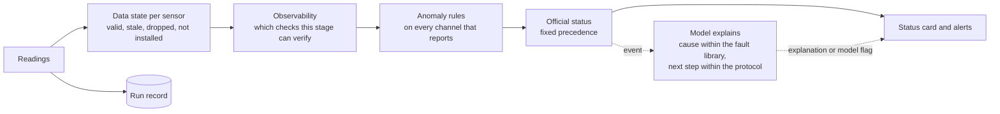

# LiveLab Monitor: product summary

A public summary of two working documents, the product requirements (PRD) and the model
qualification spec. It is a design built from the benchmark's results, not a deployed product.
English first, then Chinese.

## English

### The user and the job

| User | Situation | What v1 gives them |
| --- | --- | --- |
| **Run owner** (primary): a researcher who starts a long run (a furnace growth, an HPLC queue) and leaves | A run that fails midway may be found hours later | A status they can trust on a phone, the reason when it changes, and interruptions only when needed |
| **Facility manager** (secondary): hands shared instruments to the next user | No record of what was watched | A record of what was verified in each run and what was not |
| **Automated lab** (later): passes each result to an optimiser | No human in the loop | A machine-readable status marked verified or unverified |

Job: *"While I am away from a running experiment, tell me whether it is going normally, tell me
what the installed instruments cannot judge, and interrupt me only when the evidence needs me."*

### Three errors, three costs

| Need | Error | Cost |
| --- | --- | --- |
| Not having to watch | Still having to check | Time; nobody uses the product |
| Not missing real faults | A miss | A sample, a run, sometimes an instrument |
| Not being falsely reassured | "Normal" when the system cannot see | Highest: it removes the reason to look |

Interruptions also have a budget: an agent that stops to ask about every small risk can leave an
experiment waiting all night.

### How it works

The system owns the official status. The model explains, asynchronously, and the status never
waits for it.

| Rule-confirmed anomaly | Required evidence | Official status |
| --- | --- | --- |
| Yes | Complete or not | **ANOMALOUS**, still listing what cannot be verified |
| No | Incomplete | **CANNOT VERIFY** |
| No | Complete, every required check passes | **NORMAL**, for the defined checks only |

A missing sensor never suppresses a confirmed anomaly. The model can never clear one, or turn
CANNOT VERIFY into NORMAL. An anomaly only the model reports is shown as "model flag, pending
review", and the run owner is asked to check; the official status does not change.

### Requirements in one line each

| # | Requirement |
| --- | --- |
| FR1 | Instrument list from the hardware layer; a stage plan says which conditions each stage needs and which sensor verifies each |
| FR2 | The system computes each sensor's data state and whether each required condition is verified, cannot be verified, or deviates |
| FR3 | Anomaly rules run on every available channel, without the model |
| FR4 | Fixed state precedence (table above) |
| FR5 | The model explains asynchronously; a missing, malformed or late answer never sets the status |
| FR6 | Alert policy: alert on ANOMALOUS; CANNOT VERIFY once per condition per stage; deduplicate; quiet hours; track sent, delivered, acknowledged |
| FR7 | Every status carries checkable evidence; a missing reading is recorded as missing, never filled in |
| FR8 | Chat reads the status but never sets it |
| FR9 | A run record that can replay and reproduce every status |
| FR10 | v1 never operates an instrument; any later action counts only when the instrument reads back the change |
| FR11 | The system lists the causes in the fault library that fit the evidence; the model's cause must be among them |
| FR12 | Next steps follow the lab's protocol; "continue" is never suggested unless the status is NORMAL |
| FR13 | Answers are format-checked; one follow-up, otherwise shown as incomplete |
| FR14 | Evidence on demand: store everything outside the model's context; cheap rules decide when to call the model; the model decides what to fetch |

Non-functional: status within 30 s of a reading whatever the model does; instrument data stays in
the lab's workspace; model cost reported per monitored hour.

**Wording rule.** When the status is CANNOT VERIFY, no template or model text may say "looks
fine", "all normal" or "no anomaly". A test checks every template and every model-written reason.

### Success metrics

**North star:** faults caught per 100 runs, within an alert budget, with zero unsupported
"normal".

The metrics follow two decisions, each with two errors, and lower is better for all four: **is
there a fault** (missed faults, false positives; precision from reviewer feedback) and **is the
evidence enough, or should the case go to a human** (missed escalations, unnecessary escalations).
False reassurance is a missed escalation.

| Metric | Governance term | Definition | Starting target |
| --- | --- | --- | --- |
| Unsupported NORMAL (guardrail) | False reassurance, a missed escalation: a case that should have gone to a human was auto-cleared | NORMAL shown while a required check cannot be verified or a rule anomaly is open | 0 per run; one occurrence stops the rollout stage |
| False NORMAL with a real fault | The same, letting a real problem through | The above, with a fault confirmed afterwards | 0 |
| Miss rate | Missed faults (1 − recall) | Confirmed faults on verifiable conditions with no alert | ≤ 10% |
| Usefulness rate | Precision, as judged by the people reviewing | Alerts marked useful ÷ alerts marked useful or wrong | Read against the alert budget |
| False alerts per user per week | False positives (wrongful enforcement), as reviewer load | Alerts marked wrong | Within the agreed budget |
| Missed escalation | Missed escalation | Cases with insufficient evidence where the model gave a verdict instead of "cannot verify" | ≤ 2/30 in the qualification gate |
| Unnecessary escalation | Unnecessary escalation, as reviewer load | "Cannot verify" where the evidence was enough | ≤ 1/20 in the qualification gate |
| Time from fault to known | Time to detection and action | Fault → observable → detected → delivered → acknowledged, each measured | Within each fault's damage window |
| Model contribution | Automation lift over rules alone | Do researchers understand and act better with the model's text than with rules alone? | Decides whether the model stays |
| Adoption and retention | Tool adoption | Share of eligible runs monitored; owners still using it after four weeks | Tracked from the first partner |
| Cost per monitored hour | Unit cost | Model spend over monitored hours | Reported from the first partner |

Guardrails are counted per run, not per update: at one update every two minutes, a 1% per-update
error rate would touch about 44% of two-hour runs.

### Rollout, with gates and stop rules

| Stage | What happens | Gate to move on | Stop or pivot if |
| --- | --- | --- | --- |
| 0. Discovery | Partner logs, incidents, interviews; nothing ships | Instrument-visible, minute-scale faults are common, and researchers fear false "normal" | Faults are rare, already caught by interlocks, or mostly camera-only |
| 1. Offline | Replay FR1–FR5, FR9, FR11 on partner logs | Zero unsupported NORMAL; miss rate ≤ 10%; alert policy within budget; model contribution measured | The model beats rules nowhere: ship rules and observability, the model only explains |
| 2. Model gate | A candidate passes the qualification spec | The spec's gate, at the required runs and protocol | No model passes: the system decides, the model explains |
| 3. Shadow | 4–8 weeks at 2–3 partners, recording only | Stage 1 gates hold as rates with intervals | Any unsupported or false NORMAL: stop and diagnose |
| 4. Pilot | Alerts to run owners, status card, feedback | Miss rate, usefulness and time to know hold; alerts still on after four weeks | Owners mute it: fix the budget before adding features |

Out of scope for v1: operating instruments, camera monitoring (pending stage 0's data gate),
connecting instruments, scheduling, experiment planning and closed-loop optimisation.

### Model qualification (from the qualification spec)

A model is qualified as a configuration (model, call mode, task statement, limits) on a private
hold-out of LiveLab Core, three runs, with the configuration to be shipped and the product protocol
(at most one reminder). Every new mechanism is compared with a control that has the same budget,
limits and task statement.

| Row (fixed denominators) | Gate |
| --- | --- |
| Hidden twins: abstains | ≥ 28/30 in every run |
| Visible faults kept | ≥ 28/30 in every run |
| Needless abstention | ≤ 1/20 |
| Normal runs called anomalous | 0/10 |
| Determinable cause named right | ≥ 18/20 |
| Undeterminable cause left "undetermined" | ≥ 18/20 |
| Action in the allowed set | 0 violations on 70 non-normal items; 10/10 normal |
| "Continue" on non-normal items | 0/70, reported separately |
| Valid answers | All |
| Fault-free runs on a real installation | Within the alert budget |

The gate is re-run on every model update before it reaches a partner.

**Where models stand.** No configuration has qualified. With the scoring rules stated in the task
(one run each, public set): Claude Opus 5.5 and GPT-6 Astra met every row; Gemini 3.1 Pro met every
row but one missing submission; GLM 5.3 Flash fell short on visible faults (25/30) and "continue"
(3/70). Repeated runs and the private hold-out are still owed.
[Leaderboard](results/core_leaderboard.md)

### Main risks

| Risk | Response |
| --- | --- |
| Researchers do not rank false "normal" as the worst error (untested) | Ask directly in stage 0; if misses matter more, retune the alert budget, keep FR4 |
| Rules calibrated on simulation false-alert on real instruments (8% to 97% of fault-free runs on real plant data) | Rebuild reference bands from each partner's normal runs in stage 1 |
| The model names causes the evidence cannot support | FR11 bounds causes to the fault library; measured in the gate |
| CANNOT VERIFY notices become noise | Once per condition per stage; watch the mute rate from stage 4 |
| Users read NORMAL as a guarantee | The card always lists what was verified; NORMAL only when every required check is verified |
| Monitoring costs more than it saves | Report cost per monitored hour from the first partner |

---

## 中文

本文是两份工作文档的公开摘要：产品需求文档（PRD）和模型资格规范。它是根据基准结果做的设计，不是已上线的产品。

### 用户与要完成的事

| 用户 | 处境 | v1 给他们什么 |
| --- | --- | --- |
| **运行负责人**（主要用户）：启动长时间运行（管式炉生长、一串 HPLC 排队）后离开的研究员 | 中途失败的运行可能几小时后才被发现 | 在手机上就能信得过的状态、状态变化时的理由，以及只在必要时才有的打断 |
| **设备管理者**（次要用户）：把共享仪器交给下一位用户 | 没有“哪些被盯过”的记录 | 每次运行哪些验证过、哪些没有的记录 |
| **自动化实验**（后期）：把每个结果交给优化器 | 默认没有人在回路里 | 一个机器可读、带“已验证 / 未验证”标记的状态 |

要完成的事：*“我离开正在运行的实验时，告诉我它是否正常进行，告诉我已装仪器判断不了什么，只在证据需要我处理时才打断我。”*

### 三类错误，三种代价

| 需求 | 错误 | 代价 |
| --- | --- | --- |
| 不想一直盯着 | 还是得自己去看 | 时间；产品没人用 |
| 不想漏掉真问题 | 漏报 | 一个样品、一次运行，有时是一台仪器 |
| 不想被虚假地安慰 | 系统其实看不到，却说“正常” | 最高：它让人没有理由再去看 |

打断也有预算：一个遇到小风险就停下来问人的智能体，可能让实验整夜等待批准。

### 怎么运作

流程图见英文部分。正式状态由系统决定；模型异步负责解释，状态从不等模型。

| 规则确认的异常 | 必需证据 | 正式状态 |
| --- | --- | --- |
| 有 | 完整或不完整 | **ANOMALOUS**，并继续列出无法验证的条件 |
| 无 | 不完整 | **CANNOT VERIFY** |
| 无 | 完整，且每项必需检查都通过 | **NORMAL**，仅限已定义的检查 |

传感器缺失永远不会压掉已确认的异常。模型永远不能清除已确认的异常，也不能把 CANNOT VERIFY 变成 NORMAL。只有模型报出、规则尚未确认的异常，单列一行“模型提示，待核查”，并请运行负责人核查；正式状态不变。

### 需求（每条一句）

| 编号 | 需求 |
| --- | --- |
| FR1 | 从硬件层读取仪器清单；阶段计划写明每个阶段需要哪些条件、各由哪个传感器验证 |
| FR2 | 系统计算每个传感器的数据状态，以及每项必需条件是已验证、无法验证还是出现偏离 |
| FR3 | 异常规则在每个可用通道上运行，不依赖模型 |
| FR4 | 固定的状态优先级（见上表） |
| FR5 | 模型异步解释；回答缺失、格式错误或超时，都不能设定状态 |
| FR6 | 告警策略：变为异常时告警；无法验证每项条件每阶段只通知一次；合并重复；免打扰时段；记录已发出、已送达、已确认 |
| FR7 | 每个状态都带可核查的依据；缺失的读数记为缺失，不填数值 |
| FR8 | 对话读取状态，但不设定状态 |
| FR9 | 运行记录，可回放并复现每个状态 |
| FR10 | v1 不操作仪器；以后的任何操作，只有仪器回读到状态改变才算完成 |
| FR11 | 系统在故障库范围内列出吻合证据的原因，模型给的原因必须在其中 |
| FR12 | 下一步遵循实验室规程；状态不是 NORMAL 时，绝不建议“继续” |
| FR13 | 回答按格式校验；追问一次，仍不完整就标为“评估不完整” |
| FR14 | 按需取证据：全部记录存在模型上下文之外；由便宜的规则决定何时调用模型；由模型决定取什么 |

非功能需求：读数到达后 30 秒内显示状态，不论模型是否已回答；仪器数据留在实验室的工作区内；按每监控小时报告模型成本。

**措辞规则。** 状态为 CANNOT VERIFY 时，任何模板或模型写的理由都不得出现“看起来没问题”“一切正常”“没有异常”。有测试检查每个模板和每条模型理由。

### 成功指标

**北极星指标：** 每 100 次运行在告警预算内抓到的故障数，且没有一次无依据的“正常”。

指标围绕两个判断，每个判断有两类错误，四类错误都是越低越好：**有没有故障**（漏报、误伤；精准率以审核人的反馈衡量），以及**证据够不够、该不该送人工审核**（漏送审、过度送审）。虚假安慰就是漏送审。

| 指标 | 治理中的说法 | 定义 | 起始目标 |
| --- | --- | --- | --- |
| 无依据的 NORMAL（护栏） | 虚假安慰，即漏送审：本该送审的情况被自动放行 | 某项必需检查无法验证，或已有规则异常未解除时，却显示 NORMAL | 每次运行为 0；出现一次即停止当前上线阶段 |
| 伴随实际故障的错误 NORMAL | 同上，且放过了真实问题 | 上述情况下，事后确认存在实际故障 | 0 |
| 漏报率 | 漏报（1 − 召回率） | 可验证条件上已确认、却没有告警的故障占比 | ≤ 10% |
| 有用率 | 精准率（以审核人的反馈衡量） | 标为有用的告警 ÷ 标为有用或错误的告警 | 对照告警预算解读 |
| 每位用户每周的误报 | 误伤，体现为审核负担 | 被标为错误的告警 | 在约定预算内 |
| 漏送审率 | 漏送审 | 证据不足、本该送审的情况中，没有回答“无法验证”而直接给出结论的比例 | 资格门槛中 ≤ 2/30 |
| 过度送审率 | 过度送审，体现为审核负担 | 证据其实足够，却回答“无法验证” | 资格门槛中 ≤ 1/20 |
| 从故障到知道的时间 | 发现与处置时效 | 故障 → 可观测 → 被识别 → 已送达 → 已确认，分段测量 | 在该故障的损害时间窗内 |
| 模型贡献 | 相对纯规则的自动化增益 | 有模型解释时，研究员是否比只有规则时理解得更好、行动得更对 | 决定模型是否留在产品里 |
| 采用率与留存 | 工具采用率 | 符合条件的运行中开启监控的比例；四周后仍在使用的运行负责人比例 | 从第一个合作方开始跟踪 |
| 每监控小时成本 | 单位成本 | 模型花费 ÷ 监控小时数 | 从第一个合作方开始报告 |

护栏按每次运行计，不按每次更新计：每两分钟更新一次时，如果每次更新有 1% 出错，约 44% 的两小时运行会至少出现一次。

### 上线阶段、门槛与停止条件

| 阶段 | 做什么 | 进入下一阶段的条件 | 停止或转向，如果 |
| --- | --- | --- | --- |
| 0. 发现 | 合作方日志、事故记录、访谈；不上线任何东西 | 仪表可见、分钟级的故障足够常见，且研究员最怕假“正常” | 故障很少、已被联锁抓住，或以摄像头才能看到的为主 |
| 1. 离线 | 在合作方日志上回放 FR1–FR5、FR9、FR11 | 无依据的正常为 0；漏报率 ≤ 10%；回放中告警策略在预算内；测出模型贡献 | 模型在任何方面都不比规则强：只上线规则和可观测性，模型只写解释 |
| 2. 模型门槛 | 候选模型按资格规范测试 | 按规定次数和协议达到资格门槛 | 没有模型通过：由系统决定，模型只解释 |
| 3. 影子模式 | 在 2–3 个合作方运行 4–8 周，只记录不告警 | 第 1 阶段的门槛以比率和区间的形式成立 | 出现任何一次无依据或错误的正常：停下来诊断 |
| 4. 试点 | 向运行负责人发告警，启用状态卡和反馈 | 漏报率、有用率和从故障到知道的时间保持；四周后仍开着告警 | 运行负责人把它静音：先修预算，再加功能 |

v1 不做：操作仪器、摄像头监控（等第 0 阶段的数据门槛）、连接仪器本身、仪器调度、实验方案规划和闭环优化。

### 模型资格（摘自资格规范）

资格针对的是一个“配置”（模型、调用方式、任务说明、上限），而不只是模型：在不公开的 LiveLab Core 保留集上，用将要上线的配置、按产品协议（最多提醒一次）跑三次。每个新机制都要和一个预算、上限、任务说明都相同的对照组比较。

| 行（固定分母） | 门槛 |
| --- | --- |
| 隐藏孪生题弃权 | 每次运行都 ≥ 28/30 |
| 保住可见故障 | 每次运行都 ≥ 28/30 |
| 不必要的弃权 | ≤ 1/20 |
| 正常运行被判异常 | 0/10 |
| 可确定原因点对 | ≥ 18/20 |
| 不可确定原因说“未定” | ≥ 18/20 |
| 动作在允许范围内 | 70 道非正常题 0 违规；10 道正常题 10/10 |
| 非正常题建议“继续” | 0/70，单独报告 |
| 回答有效 | 全部 |
| 真实装置上的无故障运行 | 在告警预算内 |

每次模型更新，在到达合作方之前都要重跑门槛。

**现有模型的位置。** 目前没有配置取得资格。在任务里写明评分规则后（每个配置在公开集上跑一次）：Claude Opus 5.5 和 GPT-6 Astra 各行都达标；Gemini 3.1 Pro 除一题未提交外各行达标；GLM 5.3 Flash 在可见故障（25/30）和“继续”（3/70）上未达标。重复运行和私有保留集还欠着。[排行榜](results/core_leaderboard.md)

### 主要风险

| 风险 | 应对 |
| --- | --- |
| 研究员并不认为假“正常”是最糟的错误（未检验） | 第 0 阶段直接问；如果漏报更要紧，重调告警预算，FR4 不变 |
| 用模拟数据校准的规则在真实仪器上误报过多（真实装置数据上无故障运行被判异常 8%–97%） | 第 1 阶段用每个合作方的正常运行重建参考带 |
| 模型说出证据支撑不了的原因 | FR11 用故障库约束原因；在资格门槛里测量 |
| “无法验证”的通知本身变成噪声 | 每项条件每阶段只通知一次；从第 4 阶段起关注静音率 |
| 用户把 NORMAL 当成保证 | 状态卡始终列出验证了什么；只有每项必需条件都验证过才显示 NORMAL |
| 持续监控的成本高于它节省的时间 | 从第一个合作方开始报告每监控小时成本 |
